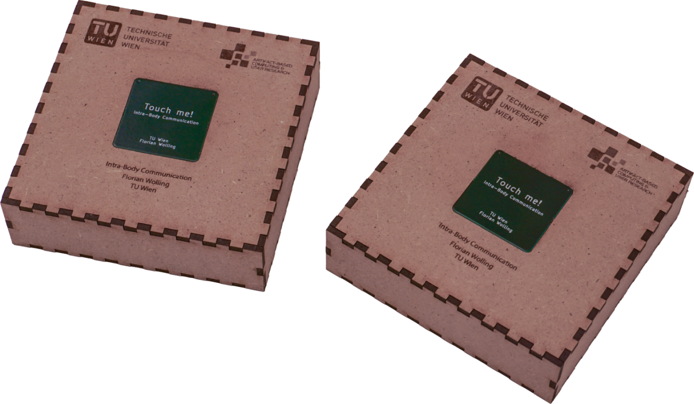

# IBC2Experience
## An Open-Source and Easy-to-Build Intra-Body Communication Demonstrator for Hands-on User-Centric Research

### Description
Intra-Body Communication (IBC) is an emerging communication technology that enables wearable devices the energy-efficient and secure data transmission across the user's body. Despite its technical promise for Wireless Body Area Networks (WBANs), the opportunity to leverage IBC for the augmentation of touch interactions by seamlessly establishing ad-hoc communication channels between devices has remained largely unconsidered. One reason for this gap might be that IBC has not yet reached commercial markets, leaving off-the-shelf evaluation boards unavailable to non-technical researchers. To address this challenge, we presented an open-source demonstrator prototype at MUM '26 in Glasgow, United Kingdom that is designed to facilitate user-centric research in the fields of Human-Computer Interaction (HCI) and User Experience (UX). Our demonstrator allows novices, such as visitors of a demonstration, to directly experience the unique characteristics that set IBC apart from conventional wireless communication technologies such as Wi-Fi, Bluetooth, and NFC. By providing an accessible, open-source, and easy-to-build platform, we aim to encourage the research community to reproduce and adopt our prototype, thereby opening new ways for the exploration of IBC from a user-centric perspective. 
In this GitHub repository, we provide the design files of the enclosure and, in particular, the open-source software, programmed in Python, to use the Digilent Analog Discovery 3 as transmitter or receiver for the signal transmission using NRZ, BPSK, or QPSK. In the evaluation, our software achieved a data rate of up to 4.8 kBit/s. We encourage researchers to replicate, adapt, and improve on our work, to develop open-source IBC transceivers and to explore their potential applications. The design files and source code of the easy-to-build demonstrator prototype are made available for download below.

### Disclaimer
You may use the design files and source code of the developed prototype for scientific, non-commercial purposes, provided that you give credit to the owners when publishing any work based on it. We would also be very interested to hear back from you if you use our prototype or files in any way and are happy to answer any questions or address any remarks related to it.

### History
#### <a href="#demonstrator-0v1">Demonstrator V0.1 -- 2026-11-19</a>
The *IBC2Experience* demonstrated was presented at the <a href="https://www.mum-conf.org/2026/" target="_blank">MUM</a> conference in Glasgow, United Kingdom on Wednesday, December 2, 2026.

### <a id="demonstrator-0v1">Demonstrator V0.1</a>
The first version of the open-source IBC demonstrator is built around the commercially available, off-the-shelf multi-function test and measurement device <a href="https://digilent.com/shop/analog-discovery-3/" target="_blank">Digilent Analog Discovery 3</a> and achieved a data rate of up to 4.8 kBit/s.

#### Citation
"[IBC2Experience: An Open-Source and Easy-to-Build Intra-Body Communication Demonstrator for Hands-on User-Centric Research](not_yet_published.html)", <a href="https://informatics.tuwien.ac.at/people/florian-wolling/" target="_blank">Florian Wolling</a>, Christoph Haslinger, and <a href="https://informatics.tuwien.ac.at/people/florian-michahelles/" target="_blank">Florian Michahelles</a>. In *Proceedings of the 25th International Conference on Mobile and Ubiquitous Multimedia (MUM '26)*, Glasgow, United Kingdom, ACM, December 01--04, 2026. <a href="https://doi.org/10.1145/3861188.3861269" target="_blank">https://doi.org/10.1145/3861188.3861269</a>

#### Design Files

#### Source Code
